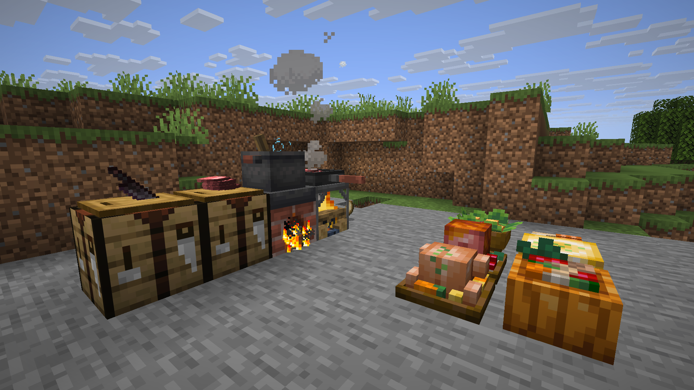
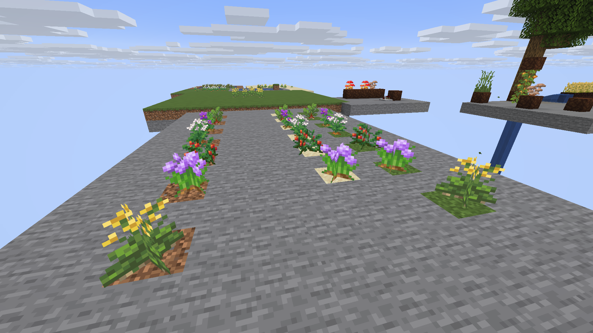
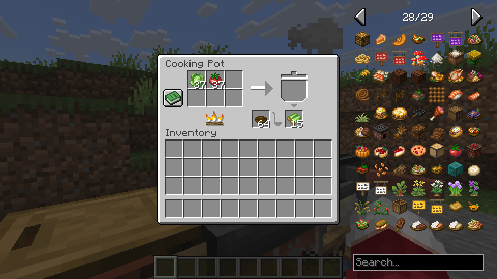

# Farmer's Delight — Sunrise port

A native [Sunrise](https://github.com/sunrise-org/sunrise) mod porting Farmer's Delight Refabricated 3.6.30
(Minecraft 26.3): cooking pot, stove, skillet, cutting board and knives, crops (cabbages, onions, tomatoes, rice),
rich soil and organic compost, mushroom colonies, wild crops and village additions, feasts and pies, all the meals,
drinks and pet foods with Nourishment and Comfort, storage blocks, baskets, cabinets, canvas signs, tatami, safety
net, rotten tomatoes, the Backstabbing enchantment, loot additions, advancements, the cooking pot recipe book, HUD
overlays, tooltips, config files and FD's 44 translations.

Version `3.6.30-sunrise.1` (Farmer's Delight 3.6.30, Minecraft 26.3), built for Sunrise `2d8126336e579777eabf9b2fd8b3d476236a04f2`
(signed SDK `sdk-2d81263…`). Until `3.6.30-horizon.3` (tag `v3.6.30-horizon.3`) the port targeted Horizon `afe471cf`;
the target is set in `tools/target.toml.in`.

**Download:** [Releases](https://github.com/play-go/farmersdelight-sunrise/releases) (`ported_farmersdelight-<version>.smod` with its SHA-256).

**Add-ons ported alongside it:** [Corn Delight](https://github.com/play-go/corndelight-sunrise) and [More Delight](https://github.com/play-go/moredelight-sunrise). Each needs this exact base version.

## Screenshots







## Install

1. Unpack `ported_farmersdelight-<version>.smod` from the release (or put this repository's source) in a mods
   folder, or install it with `sunrise-launcher mods add-github https://github.com/play-go/farmersdelight-sunrise`.
2. Build it for the instance: `sunrise-launcher native-build <mods folder> --instance <instance> --trust-native-code`
   (native code runs with your rights).
3. Start the game. Settings are in `config/ported_farmersdelight-common.json` and
   `config/ported_farmersdelight-client.json` (FD's keys and layout; edits apply while the game runs, except the
   item-default keys, see below).

A dedicated server is exported with `sunrise-launcher native-build <mod folder> --server-output <dir> --version <build> --trust-native-code`.

**Multiplayer:** every player needs the Sunrise client with this same mod build. Clients without it are refused
("Your mods don't match this server's").

## Differences from Farmer's Delight

The port keeps FD's behaviour, quirks included. Where the engine could not express something, the difference is
recorded as an accepted delta (A-nn) with its engine gap (E-nn) in `PROGRESS.md`. The ones a player may notice:

- the item-default config keys (stackable soups, rabbit stew buff, vanilla soup Nourishment, straw bed rename) have
  no effect: the engine reads config files after building item defaults (E-35, A47);
- the village config keys cannot switch off FD's village additions (E-26, A26);
- in single player, clicking a recipe in the cooking pot's recipe book does not place it (it works on servers;
  E-36, A48); the book's tabs are ordered Drinks, Meals, Misc (A49);
- the Comfort overlay ignores absorption hearts (A50); tooltip durations assume 20 ticks per second (A51);
- standing canvas signs open the text editor when placed (E-31, A34); a custom name is lost when a cabinet or
  basket is broken by something other than a player (E-30, A33);
- on page 2 of the creative inventory, the hovered tab's name can be drawn under a page-1 tab name (engine, E-39).
- `enableVanillaCropCrates = false` no longer removes the carrot, potato and beetroot crate recipes: Sunrise's
  startup recipe load refuses a recipe whose mod-registered condition it does not know (E-43, A53). The default
  (`true`) behaves as FD.

## For add-on authors

Depend on the exact base version, as the API may change in any release:

```toml
[dependencies]
ported_farmersdelight = "=3.6.30-sunrise.1"
```

What stays stable while `fd_port_api` (a `[properties]` value in `sunrise-mod.toml`, also
`ported_farmersdelight::api::API_VERSION`) is unchanged:

- the Rust module `api` for native add-ons (the launcher adds the base as the Cargo dependency
  `ported_farmersdelight`);
  - `api::feast`: FD's `FeastBlock` behaviour for an add-on's feast block (`register`, `take_serving`,
    `servings`, `decide`; `register_custom` for a feast with its own use);
  - `api::wild_crop`: FD's `WildCropBlock` behaviour (`register`, `may_place_on`, `bonemeal_spread`,
    `suspicious_stew_effect`, …);
  - `api::config`: FD's boolean config keys by name (`common_bool`, `client_bool`), and
    `farmers_buy_fd_crops()` for add-ons written against upstream FD (always true here);
  - `api::crop`: vanilla `CropBlock.getGrowthSpeed` and draws from the level's random (`growth_speed`,
    `next_int`, `next_float`);
- the add-on tag overlay format (`tools/addon_overlays/`), which adds an add-on's ids to FD's own tags;
- the item tags `ported_farmersdelight:effect_tooltip` (food-effect tooltip lines) and
  `ported_farmersdelight:knife_items` (items that work as FD knives), and the base's load conditions.

A change that breaks any of these raises `fd_port_api`. Every base release changes the version, so add-ons are
re-released against it. FD's recipe types (`farmersdelight:cooking`, `farmersdelight:cutting`) accept recipes from
any namespace.

## Building from source

`sunrise-mod.toml [native] sunrise` names the Sunrise build; `Cargo.toml` takes the API from that build's signed SDK
(`.sunrise/sdk/api`, fetched by `cargo sunrise-mod check`). Local checks (Rust 1.99.1; `<FD checkout>` is Farmer's Delight Refabricated at the commit in `NOTICE`):

```sh
cargo fmt --all --check
cargo clippy --all-targets --locked -- -D warnings
cargo test --locked
python3 tools/gen_decls.py --check && python3 tools/gen_worldgen.py --check
python3 tools/gen_food_tooltips.py --check
python3 tools/carry_fd.py --fd <FD checkout> --fapi <Fabric API checkout> --check
for t in tools/test_*.py; do python3 "$t"; done
cargo sunrise-mod check      # fetches and verifies the SDK, then checks the crate
cargo sunrise-mod build      # target/sunrise-mod/ported_farmersdelight.smod
```

Carried Farmer's Delight data under `assets/` and `data/`, and Fabric API's convention tags under `data/c/tags/`, are
written by `tools/carry_fd.py`; never edit them by
hand. Block and item declarations come from `tools/decl/*.toml.in` through `tools/gen_decls.py`.

## Licence

This port's code is MIT (`LICENSE`). Farmer's Delight's data, assets and behaviour are MIT, © 2020 vectorwing
(`LICENSE-farmersdelight`). The `data/c/tags/` files come from Fabric API, Apache-2.0 (`LICENSE-fabric-api`). Credits
and the excluded LGPL files are listed in `NOTICE`.
